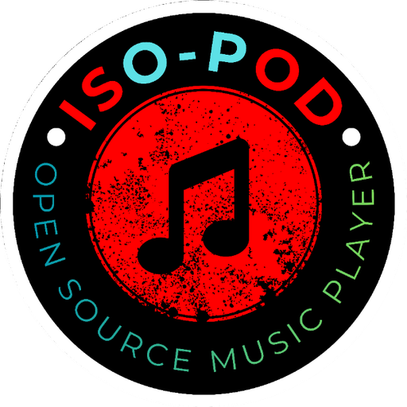

<div align="center">




### **ISO pod** — *Pure Sound. Pocket Hi-Fi.*

[](https://github.com/Rohanjm911/IOS-pod/stargazers)
[](LICENSE)
[](https://www.typescriptlang.org/)
[](https://vitejs.dev/)
[](https://pnpm.io/)

</div>

---

## ✨ What is ISO pod?

**ISO-pod (Web App Version)** (*Pure Sound. Pocket Hi-Fi.*) is an open‑source music streaming platform based on **BitChord**, built primarily for **iOS devices** and also seamlessly usable across Android, tablets, laptops, and desktop browsers — no subscriptions required. It lets you **import playlists from any major streaming service** and enjoy uninterrupted, high‑fidelity playback anywhere.

> Import from Spotify, YouTube Music, Deezer, Audius, and Apple Music / iTunes → Match tracks across multiple sources → Play with a fluid, customizable iOS‑inspired UI, 10-band studio EQ, and cinema-grade startup experience.

---

## 🧰 Tech Stack

<div align="center">


</div>

| Layer | Technologies |
|---|---|
| **Frontend & UI** |      |
| **State & Data** |   -F7DF1E?style=flat-square&logo=javascript&logoColor=black) |
| **Audio, DSP & Streaming** |      |
| **Build, Edge & Testing** |      |

---

## 🚀 Features & Implementation Timeline

### 🆕 Newly Implemented Features

| # | Feature | Implementation Date & Time | Description |
|---|---|---|---|
| **1.** | 💿🔄 **Vinyl Mode Spin & Spindle Fix** | Nov 27, 2026 • 10:24 IST | Fixed `FullScreenPlayer.tsx` vinyl mode not spinning when Apple `MotionArtwork` overlaid the static ``: wrapped both artwork and `MotionArtwork` in a dedicated rotating disc container (`spin 14s linear infinite`, paused when playback pauses) and placed the vinyl center spindle at `z-10` above motion art. |
| **2.** | 🛠️📱 **Landscape PlayerBar & Customizer Popover Fix** | Nov 27, 2026 • 10:20 IST | Fixed `PlayerBar.tsx` overflow/squashed LCD on compact & phone-landscape widths (`< 1024px`) by adding `overflow-hidden` on the pill & LCD container and collapsing secondary controls (`Shuffle`, `Repeat`, `Favorite`, `TrackMenu`) into Quick Tools / Full-Screen; prevented `Sidebar.tsx` tagline wrapping; and added `max-h-[calc(100dvh-...)] overflow-y-auto` to the `FullScreenPlayer.tsx` Customizer popover so its header never clips on short screens. |
| **3.** | 📱🖥️ **All-Screen Responsive Optimization** | Nov 27, 2026 • 10:13 IST | Added responsive layout tokens in `tokens.css` for small phones (`<=420px`: `16px` gutter), tablets (`768px–1023px`: `220px` sidebar), and ultrawide monitors (`>=1600px`: fluid gutter + `340px` side panel); switched `EqualizerModal`, `ThemeModal`, and `SleepTimerModal` to `100dvh` + safe-area padding; added `touch-action: manipulation`, `overscroll-y-contain`, tighter mobile `--art` bounds in `FullScreenPlayer.tsx`, and `xl`/`2xl` grid columns in `SearchPage.tsx`. |
| **4.** | 📐💿 **Full-Screen Vinyl & Card Alignment Fix** | Nov 27, 2026 • 10:03 IST | Fixed `FullScreenPlayer.tsx` centered card overflow where `.fullscreen-art` used `w-(--art)` inside a padded `w-(--art)` container, causing the vinyl disc to touch the right edge; centered artwork with balanced `p-6 pb-5` card padding and clean visualizer bottom spacing. |
| **5.** | 🧹✨ **Complete "BitChord" → "ISO pod" App Scrub** | Nov 27, 2026 • 09:54 IST | Replaced all remaining `BitChord` / `bitchord` references across UI pages, modals, Discord/Spotify/YouTube/Extension prompts, Audius `app_name`, EQ export filenames, CSS custom properties & font family (`ISOpod SF Pro Display`), `localStorage` keys (`isopod:*`), browser extension metadata (`wxt.config.ts`), and edge proxy service labels. |
| **6.** | 🔊🎬 **Dramatic Cinema Startup Sound Engine** | Nov 27, 2026 • 09:44 IST | Upgraded `StartupScreen.tsx` Web Audio synthesizer with a dynamics compressor, cinema-hall echo tail, pre-hit filtered noise whoosh riser, dual-layer `"Ta-Dum"` sub-bass drop (`94 Hz → 38 Hz`), and a 6-voice detuned orchestral synth-brass chord swell synced with the multi-color ribbon burst. |
| **7.** | 🎨💿 **Custom ISO-POD Logo & Icon Suite** | Nov 27, 2026 • 09:42 IST | Replaced the old app logo everywhere with the new circular **ISO-POD** badge (`logo.png`), anti-aliased with transparent edges and generated across all sizes (`favicon.png`, `apple-touch-icon.png`, `icon-192.png`, `icon-512.png`, `icon-maskable-512.png`), plus updated `LogoMark.tsx`, `index.html`, and the circular Netflix-style `StartupScreen.tsx` centerpiece. |
| **8.** | 🏷️🎧 **App Rebrand to "ISO pod" + Tagline** | Nov 27, 2026 • 09:36 IST | Rebranded all user-facing app titles, manifest (`manifest.webmanifest`), `index.html`, Netflix-style `StartupScreen.tsx`, `Sidebar.tsx`, `MobileTopBar.tsx`, and empty/status prompts to **ISO pod** with the fitting tagline **"Pure Sound. Pocket Hi-Fi."** |
| **9.** | 🛡️⏱️ **Site-Wide Proxy & Client Rate Limiter** | Nov 27, 2026 • 09:24 IST | Implemented multi-layer rate limiting across the entire site: sliding-window per-IP rate limiting (`120` API reqs/min, `240` media/range reqs/min, bounded bucket pruning, `429 Retry-After` + `X-RateLimit-*` headers) in Vercel Edge (`api/proxy.js`, `web/api/proxy.js`), Cloudflare Worker (`web/ios-proxy/worker.js`), and Vite local proxy (`vite.config.ts`), paired with a token-bucket + 429-backoff client rate limiter (`rateLimiter.ts`) integrated into search and external source APIs. |
| **10.** | 🎨💿 **Mochy-Style Full-Screen Player Customizer** | Nov 27, 2026 • 01:45 IST | Added a live inline Full-Screen Customizer (`FullScreenPlayer.tsx` + `ui.ts`) accessible via the top **Customize** pill or bottom **Sparkles** icon: switch Artwork Styles (**Classic**, spinning **Vinyl** disc with center spindle, **Soft** squircle, **Minimal**), Backdrops (**Mesh**, **Aurora**, **Frosted**, **AMOLED**), Stage Layouts (**Apple Split**, **Mochy Flip**, **Glass Card**), and Audio Visualizer visibility with instant persistence. |
| **11.** | 🎛️✨ **Customizable Player Bar Styles** | Nov 27, 2026 • 01:14 IST | Added 4 live-switchable Player Bar visual styles (`Apple Glass`, `Compact Pill`, `Studio Dock`, and `Neon Glow`) persisted in `ui.ts` (`bitchord:player-style`), selectable from both the quick Theme Customizer modal (`ThemeModal.tsx`) and `SettingsPage.tsx`, and applied dynamically across desktop `PlayerBar.tsx` and `MobilePlayerBar.tsx`. |
| **12.** | 🛡️▶️ **Resilient Multi-Tier Playback & Embed Fallback Fix** | Nov 27, 2026 • 00:00 IST | Fixed intermittent playback failures when tracks hit YouTube embed restrictions (`Error 101/150`) or bot-gates: filtered out non-YouTube IDs (`audius:` / `itunes:`) from YouTube IFrame `tryEmbed`, parallelized `searchSongs` + `searchMainVideos("${query} audio")` up to 6 embeddable fallback candidates, added Audius full-MP3 stream fallback in `YouTubeEngine.load()` catch recovery, and enabled automatic radio advance when a single unplayable track fails. |
| **13.** | 🌐🎵 **Multi-Source Built-In Song Fetching & Streaming (Audius + iTunes)** | Nov 26, 2026 • 23:39 IST | Added built-in non-YouTube music fetching and playback (`externalSources.ts`): integrates **Audius Discovery Network** (direct 320kbps MP3 full-track streaming, CORS-enabled, zero bot-gate, full 10-band EQ & visualizer support) and **Apple iTunes Search API** into `fetchSearch`, `searchSongs`, `genreRadio.ts`, and `YouTubeEngine.load()` automatic fallback—so songs search, load, and play even without YouTube or browser extensions. |
| **14.** | 🌟🚀 **Netflix-Style Multi-Color Startup Splash Screen & Sound** | Nov 26, 2026 • 23:52 IST | Upgraded `StartupScreen.tsx` with a cinematic pitch-black stage, 10 Netflix-inspired multi-color vertical spectrum light ribbons (`netflix-ribbon`), conic-gradient ambient glow, spring-scaled glass `LogoMark` badge with light-sheen sweep, multi-color gradient `"BitChord"` wordmark with `netflix-zoom` transition, 5-bar neon equalizer, synthesized Web Audio `"Ta-Dum"` sub-bass + harmonic chord startup sound effect (isolated strictly to startup), tap-to-skip, and `prefers-reduced-motion` support. |
| **15.** | ⏩🎬 **Auto-Detect & Skip Intros & End Credits** | Nov 26, 2026 • 23:26 IST | Multi-tier automatic intro, non-music skit, and end-credits skipper: Tier 1 queries SponsorBlock (`music_offtopic`, `intro`, `outro`) with segment merging and caching; Tier 2 analyzes synced lyrics vocal boundaries (`>= 20s` opening delay and `>= 18s` trailing credits); Tier 3 monitors real-time Web Audio `AnalyserNode` silence tails (`>= 4s`) to automatically advance to the next track; plus user toggle in Settings and manual-seek re-watch protection. |
| **16.** | ⏭️⏮️ **Next & Previous Transport Buttons Fix** | Nov 26, 2026 • 20:05 IST | Resolved non-functional Next and Previous track controls across PlayerBar, FullScreenPlayer, MiniPlayer, and MobilePlayerBar: eliminated artificial `!hasNext` button disabling so transport is always active; wired hardware `unlockAudioOnGesture()` to both buttons to prevent browser audio context drops; enhanced `previous()` with double-tap (<2s) and beginning-of-track detection to instantly jump to previous tracks instead of perpetually seeking to 0; and strengthened `advance()` with auto-looping, same-genre radio refill, and automatic skipping of unplayable tracks. |
| **17.** | 📻🎶 **Intelligent Same-Genre Auto-Loading Radio Engine** | Nov 26, 2026 • 19:55 IST | Automatically detects the musical genre and acoustic vibe of any currently playing song (via iTunes Search API with fallback heuristic taxonomy across Bollywood, Punjabi, Dance/EDM, Rock, Pop, Hip-Hop, Lo-Fi, etc.), auto-loads a continuous Up Next queue of same-genre tracks with multi-tier fallback (YouTube Music Radio -> YTM Songs shelf -> YouTube Video Search), dynamically refills the queue when low (<= 2 tracks), and eliminates stalled or abrupt playback endings. |
| **18.** | 🔊🔇 **Volume Slider & Mute Toggle Bridge Fix** | Nov 26, 2026 • 19:40 IST | Fixed master volume slider and mute speaker button by keeping `deck.audio.volume` and `deck.audio.muted` synchronized across both IframePlayerAdapter (YouTube Iframe embed bridge) and native HTMLMediaElement outputs alongside Web Audio `eqMasterGain`, added continuous real-time `onInput` dragging, added `stopPropagation` on mute button taps, and auto-restored 50% volume when unmuting from 0%. |
| **19.** | ⚡🔊 **Studio Equalizer Live DSP Routing Engine Fix** | Nov 26, 2026 • 19:35 IST | Decoupled 10-Band Equalizer from the heavy Automix DJ scheduler into a dedicated Web Audio DSP pipeline; attached deck HTMLAudioElements directly via cached MediaElementAudioSourceNodes; wired hardware gesture AudioContext automatic resume across all gestures, slider adjustments, and preset clicks; routed master and deck fader volumes cleanly through eqMasterGain; and restored live real-time audible acoustic processing with visual pulsing DSP indicators. |
| **20.** | 🎚️ **10-Band Studio Sound Equalizer with Custom Preset Import/Export** | Nov 26, 2026 • 19:05 IST | Upgraded from 5 to 10 ISO octave frequency bands (32 Hz to 16 kHz), added 14 popular studio genre presets (Bass Boost, Bass Reducer, Vocal Booster, Treble Booster, EDM, Rock, Hip-Hop, Pop, Acoustic, Classical, Jazz, Deep Lounge, Dialogue), wired real-time Web Audio biquad filter chain directly into playback, and added full custom preset management with JSON import/export and 5-to-10 band interpolation. |
| **21.** | ✨ **Apple-Grade Micro-Animations & Motion Polish** | Nov 26, 2026 • 18:55 IST | Hardware-accelerated dynamic artwork radiosity breathing bloom (`4.5s` pulse during playback), spring modal popups (`cubic-bezier(0.16, 1, 0.3, 1)`), tactile spring physics on transport controls (`hover:scale-108 active:scale-92`), and accent-color reactive audio visualizer with illuminated white tips. |
| **22.** | ⚡ **Lyrics Animation Polish & Zero-Delay Sync Engine** | Nov 26, 2026 • 18:51 IST | Removed awkward line bobbing/wobble and character jitter; introduced rock-solid Apple Music typography, clean opacity hierarchy (no greasy blur), and crystal-clear ambient radiosity glow. Accelerated clock slew rate (`CORRECTION_MS = 150`, `MAX_SLEW = 0.75`), added +220ms lead-in compensation to eliminate hardware audio buffer delay, and integrated custom sync offset slider (-200ms to +600ms) in Lyric Settings. |
| **23.** | 🎛️ **PlayerBar & Landscape Responsive Layout** | Nov 26, 2026 • 18:45 IST | Glass-pill dynamic responsive expansion (up to 840px), intelligent Quick Tools contextual popover (`SlidersHorizontal`), auto-collapsing utility buttons when side panels open, preventing UI truncation and LCD title squashing across all screen sizes. |
| **24.** | 🎤 **Fluid Apple Music Lyric Animations** | Nov 26, 2026 • 18:37 IST | Spring-driven active line entrance elevation (`scale(1.045)`), dynamic breathing radiosity karaoke glow with key-color ambient bloom, 3D progressive depth-of-field blur on inactive lines, syllable karaoke pop, tactile seek hover highlights, and dancing instrumental gap dots. |
| **25.** | 📱 **Landscape Mode Formatting Overhaul** | Nov 26, 2026 • 18:32 IST | Redesigned FullScreenPlayer layout for landscape and compact heights (≤620px): side-by-side artwork + metadata header row, isolated z-20 bottom action bar eliminating control collisions, compact scrubber, 38px transport, and auto-scaled 22px visualizer. |
| **26.** | 🖤 **Pure AMOLED Pitch Black Mode** | Nov 26, 2026 • 18:24 IST | True `#000000` pitch-black dark theme for zero-power display efficiency on OLED/AMOLED screens, deep contrast, and true-black shelves and sidebars. |
| **27.** | 🎨 **Custom Accent Colors & iOS Palettes** | Nov 26, 2026 • 18:24 IST | Live HTML5 color picker and hex input for custom button/accent tinting, 10 quick vibrant color swatches, plus 9 curated iOS palettes (Neon Pink, Electric Blue, Sunset Coral, Mint, Violet, Amber, Emerald, Cyan, Crimson). |
| **28.** | 🪟 **Glassmorphism Customizer** | Nov 26, 2026 • 18:24 IST | 4-tier background blur and translucency customization: Apple Glass (32px), Ultra Frosted (48px high saturation), Subtle Glass (12px), and Solid Flat (0px blur for high performance). Accessible from Settings and quick-palette modal. |
| **29.** | ⏰ **Sleep Timer with Volume Fade-Out** | Nov 26, 2026 • 18:13 IST | Auto-timer with presets (15m, 30m, 45m, 1h), "End of current track" watcher, or custom minute input. Features gentle 20-second volume fade-out before playback automatically pauses. |
| **30.** | 🌊 **Audio Visualizer & Waveforms** | Nov 26, 2026 • 18:13 IST | Real-time audio reactive 60 FPS canvas visualizer featuring 3 switchable modes: Spectrum Frequency Bars, Layered Flowing Oscillogram Waves, and Pulsing Particles. Powered by Web Audio AnalyserNode with rhythmic beat-clock fallback. |
| **31.** | 🎚️ **5-Band Sound Equalizer & Bass Boost** | Nov 26, 2026 • 18:13 IST | Precision 5-band biquad filter graphic EQ (60 Hz, 230 Hz, 910 Hz, 3.6 kHz, 14 kHz), 9 genre presets (Rock, Pop, Electronic, Vocal, Acoustic, Flat, etc.), live interactive SVG frequency response curve, and dedicated +12dB punchy Sub-Bass Booster. |
| **32.** | 🖼️ **Floating Mini-Player & PiP** | Nov 26, 2026 • 18:13 IST | Draggable floating glass player card with position persistence across page navigation, artwork expander, full playback scrubbers/controls, and native browser Picture-in-Picture (`video.requestPictureInPicture`). Quick shortcut: `P`. |

---

### 🎵 Core & Established Architecture Features

| Core Feature | Capabilities |
|---|---|
| 🔄 **Unlimited Playlist Import** | No track limits; supports YouTube Music (continuation tokens), Spotify (Pathfinder API pagination), Deezer (public API), and Apple Music / iTunes. |
| 🎯 **Multi-Source Strict Matching** | Automatic matching across YouTube Music catalog (primary), iTunes metadata lookup, and YouTube video search fallback with low-quality upload rejection. |
| 🔒 **Proxy Streaming & Rate Limiting** | Multi-layer sliding-window per-IP rate limiting (`120` API / `240` media reqs/min) across Vercel Edge, Cloudflare Worker, and Vite local proxy, plus client token-bucket + 429 backoff. |
| 🎧 **Seamless Playback, Radio & Automix Engine** | Continuous same-genre auto-loading radio queue, auto-skip intros/end-credits (SponsorBlock + lyrics + silence tail), shuffle, repeat, crossfade, and Web Audio DJ Automix transitions. |
| 🎚️ **10-Band Studio EQ & Audio Visualizer** | Dedicated Web Audio biquad filter pipeline (32 Hz – 16 kHz), 14 studio presets, JSON import/export, +12 dB sub-bass booster, and 60 FPS canvas waveform/bar/particle visualizer. |
| 🎤 **Word-Timed Lyrics Engine** | Powered by `@uimaxbai/am-lyrics` with TTML / LRC multi-provider fallback (Musixmatch, LRCLIB, Apple, YouTube) with full-screen and panel views. |
| 👥 **Listen Together & Live Presence** | Real-time party room sync for shared listening sessions, synced transport, and Discord Rich Presence integration. |
| 📱 **All-Screen Responsive & Customizer UI** | Adaptive layout tokens for small phones (`<=420px`), tablets (`768px–1023px`), laptops, and ultrawide (`>=1600px`) screens, with live Artwork/Backdrop/Layout/Player-Bar customizers and AMOLED black mode. |

---

### 💫 Apple-Grade Fluid Motion & Animation Architecture

**ISO pod** features an animation pipeline calibrated to match native iOS and macOS Apple Music standards:

- **GPU-Accelerated 60/120 FPS Rendering (`transform` & `opacity`)**:
  - Zero Layout Shifts (CLS = 0): Animations exclusively target compositor layers via `transform`, `opacity`, and `will-change`, preventing expensive browser reflows and layout thrashing.
- **Breathing Artwork Radiosity Pulse (`4.5s ease-in-out`)**:
  - When music plays, a blurred, hyper-saturated replica behind the album art breathes with an ambient mesh bloom (`translateY(8px..12px)`, `scale(0.96..1.02)`, `blur(22px..32px)`).
  - Pausing the track smoothly settles the artwork into its resting geometry via cubic-bezier spring curves.
- **Tactile Spring Physics on Transport Buttons**:
  - Buttons respond to touch and mouse input with physical micro-interactions: `hover:scale-108` and `active:scale-92` with `cubic-bezier(0.16, 1, 0.3, 1)`.
- **Theme-Adaptive Audio Visualizer**:
  - The real-time canvas visualizer dynamically samples the user's active theme accent (`--keyColor`), generating smooth linear gradients with pure white illuminated tips at frequency peaks.
- **Spring Modal Popups (`animate-spring-popup`)**:
  - Modals and contextual dialogs enter with custom Apple spring physics (`scale(0.92) translateY(6px)` → `scale(1) translateY(0)` in 320ms).
- **Netflix-Style Cinema Startup Splash & Sound (`StartupScreen.tsx`)**:
  - Launches with GPU-composited multi-color spectrum ribbons (`netflix-ribbon`), conic-gradient ambient glow (`startup-glow`), expanding sonar rings (`startup-ring`), diagonal glass light-sheen sweep (`startup-sheen`), spring-scaled circular **ISO-POD** `LogoMark`, 5-bar animated equalizer (`startup-eq`), and a dramatic Web Audio `"Ta-Dum"` sub-bass + 6-voice orchestral synth-brass swell, with `prefers-reduced-motion` and tap-to-skip support.

---

### 🔮 Future Features Tracker

*This section automatically documents upcoming features as they are implemented, logging their exact implementation date, time, and functional description:*

| Feature | Target Status | Planned Capabilities |
|---|---|---|
| ⏳ *Next Implemented Feature* | *Pending* | *Will be logged with exact implementation timestamp and technical notes upon deployment.* |

---

## 🛠️ Installation

```bash
# 1. Clone the repo
git clone https://github.com/Rohanjm911/IOS-pod.git
cd IOS-pod/web/app

# 2. Install dependencies
pnpm install

# 3. Start development server
pnpm dev
# → http://localhost:5173

# 4. Build for production
pnpm build
```

### ⚙️ Proxy Configuration

```bash
# Start the local proxy (required for Spotify/Deezer imports)
npx pnpm@latest --dir web/app exec vite preview --port 5173 --host
```

| Variable | Default | Description |
|----------|---------|-------------|
| `API_PROXY_URL` | `http://localhost:5173/api/proxy` | Proxy server URL |
| `PROXY_SECRET` | _(none)_ | Secret key for authenticated requests |

---

## 📖 Usage

### Importing a Playlist

1. Open the app → click **Library** → **Import Playlist**
2. Paste a playlist URL:
   - `https://open.spotify.com/playlist/...`
   - `https://music.youtube.com/playlist?list=...`
   - `https://www.deezer.com/playlist/...`
3. ISO pod fetches **all tracks** (no limit!) and matches each one across multiple sources
4. Your playlist appears in **Library** — ready to play 🎶

### Track Matching Flow

```
Playlist URL
     │
     ▼
Fetch all tracks (unlimited pagination)
     │
     ├─► YouTube Music catalog search
     │        └─► Strict match? ✅ → Use it
     │
     ├─► iTunes metadata search
     │        └─► Strict match? ✅ → Use it
     │
     └─► YouTube video fallback search
              └─► Best match → Use it
```

---

## 🧪 Development

```bash
# Run all tests
pnpm test

# Type checking
pnpm typecheck

# Lint
pnpm lint

# Preview production build
pnpm preview
```

---

## 🤝 Contributing

Contributions are welcome! Here's how to get started:

1. 🍴 Fork the repo
2. 🌿 Create a feature branch: `git checkout -b feature/my-feature`
3. ✅ Run tests: `pnpm test`
4. 📬 Submit a Pull Request

---

## 📄 License

MIT License — see [LICENSE](LICENSE) for details.

<div align="center">


Made with ❤️ by [Rohanjm911](https://github.com/Rohanjm911)

</div>
